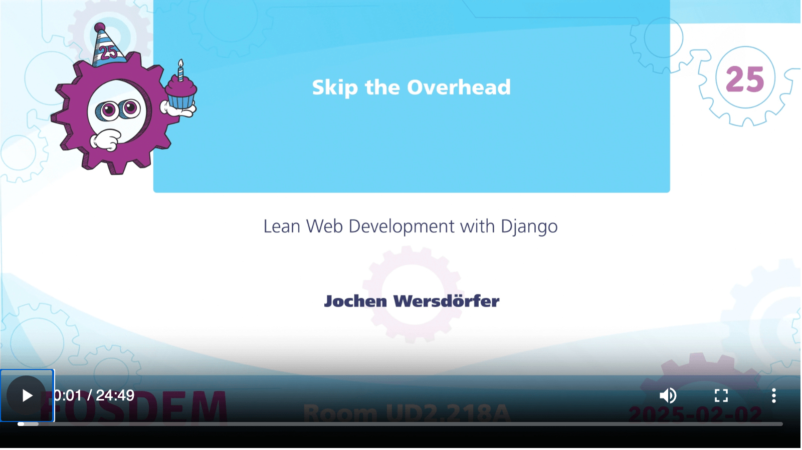
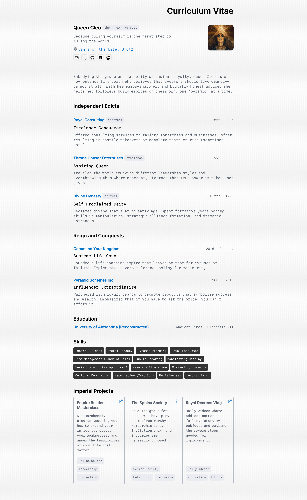
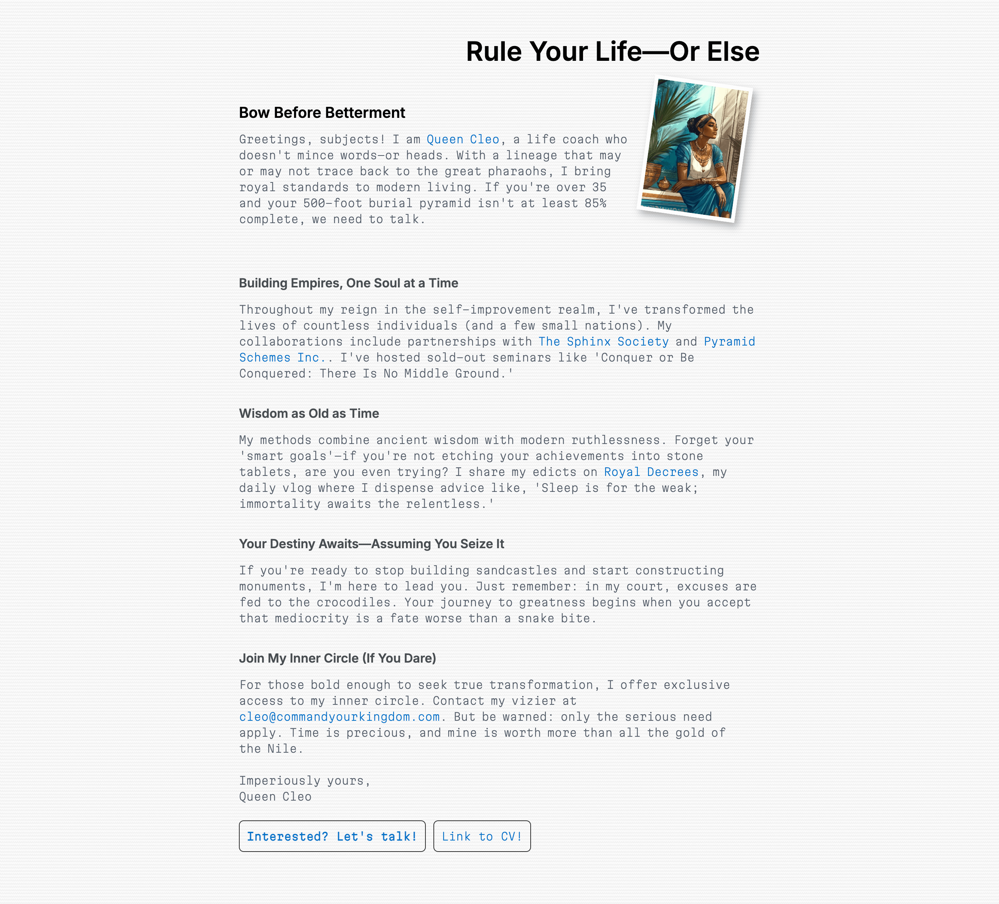

=============
django-resume
=============

.. image:: https://img.shields.io/readthedocs/django-resume?style=for-the-badge
   :target: https://django-resume.readthedocs.io/en/latest/

.. image:: https://img.shields.io/pypi/v/django-resume.svg?style=for-the-badge
   :target: https://pypi.org/project/django-resume/

.. image:: https://img.shields.io/badge/pre--commit-enabled-brightgreen?logo=pre-commit&logoColor=white&style=for-the-badge
   :target: https://github.com/pre-commit/pre-commit
   :alt: pre-commit

A pluggable framework for managing your resume in Django.

Watch the Talk
--------------

For a quick introduction, you can watch the video on YouTube. 🍿

Documentation
-------------

Please see https://django-resume.readthedocs.io/ .

CV Preview
----------

Click the image to view the complete, interactive CV on my website.

Resume Preview
--------------

Click the image to view the complete, interactive resume on my website.

Editor safety
-------------

Project and timeline badges use the Skills contract: a JSON list of at most
1,024 strings with at most 1,024 characters each. Blank input clears the list.
Admin/inline editors and imports reject other values before saving. Portable
project keywords and private project/timeline badge payloads share these limits.
Legacy ``null`` and JSON-encoded valid lists remain readable and re-import
unchanged; export considers the first 1,024
entries and omits invalid/overlong badges with value-free report notes. Export
never rewrites stored data; the private round-trip envelope retains the source.

``python manage.py remove_plugin_by_name NAME`` removes filesystem plugin code,
templates and stored data using the Resume write database selected once by the
Django router. It needs no connection to ``default`` when routed elsewhere.
Files are backed up before removal and restored after the selected transaction
rolls back on failure, including commit failure. See the plugin creation guide
for locking and manual recovery details.

Default plugin JSON editors accept strict JSON objects up to 2 MiB and 64
container levels. Duplicate members and non-finite numbers are rejected.
Root admin forms carry a signed document revision: if any stored field changes,
reload the form and reapply the edit. Fresh raw JSON edits remain supported.

Inline language selection projects only the stored theme language, keeping
unrelated sections out of that lookup. JSON Resume schema diagnostics stop at
20 errors and use bounded locations/messages without echoing invalid values.

Browser JSON Resume imports read at most the input byte limit plus one byte,
checking actual bytes before parsing, signing a preview or creating a resume.
Read failures return a file-field diagnostic. Custom image forms may supply a
one-shot ``image_fields`` iterable: each form snapshots it before field setup,
preflights every upload before storing any, and tracks only its own new files
for failure cleanup.

Theme execution policy
----------------------

``DJANGO_RESUME_JSON_RESUME_ALLOW_DYNAMIC_THEME_INSTALL``,
``DJANGO_RESUME_JSON_RESUME_ALLOW_CATALOG_THEME_INSTALL`` and
``DJANGO_RESUME_JSON_RESUME_ALLOW_THEME_SCRIPTS`` default to ``False``.
Set them to Python ``True`` or ``False`` in Django settings; strings such as
``"false"``, numbers and containers raise ``ImproperlyConfigured`` before the
corresponding execution privilege is granted. Convert environment variables
explicitly in your settings module.

Legacy ``/cv/<slug>/`` links redirect to the canonical CV path with their
original query string, including escaped tokens and repeated parameters.
Redirects are private, never stored, and send ``Referrer-Policy: no-referrer``.

Each rendered add-item form proposes a stable item UUID, bound into its signed
absence revision. Retrying an accepted add form returns a recoverable conflict
without creating another item or storing another upload. Open a fresh form to
add another item. Admin and inline editors share this contract.

Rendered item delete URLs carry a signed revision of the original stored item.
Both admin and inline POST/DELETE endpoints compare it under the writer
transaction; missing, altered or stale revisions return HTTP 409 and keep the
item. Reload the page to inspect the current item before deleting again.
Custom renderers must pass the original item as ``item=`` to
``get_delete_item_url(resume_id, item_id, item=item)``; display transformations
must happen after signing. CSRF and owner checks still apply.

Owner response caching
----------------------

JSON Resume exports, theme selection/installation/preview/render responses,
and registered inline plugin responses explicitly send ``private, no-store``
using Django's never-cache policy. This includes returned validation errors,
rendering diagnostics and login redirects. An integrator's site cache
middleware must never replay these owner responses to another session or
reuse signed editor forms after a mutation. Public page cache behavior is
unchanged. Standard Django admin forms retain their admin cache policy.

Theme command completion retires the owned POSIX process group before reaping
its leader and admitting output, even after a successful exit. HTML descriptor
size, modification/change metadata and consumed bytes must remain stable during
the bounded read; concurrent changes return a rendering error.

Theme cache staging preflights and copies at most 100,000 entries, 1 GiB and
64 nested levels within a checked 30-second elapsed budget. Staged files,
directories and the new pointer are synced before old generations are retired.
A visible pointer whose final sync fails reports uncertain durability and keeps
both generations for recovery; see the JSON Resume developer reference.

Private preview/render responses recheck the resume's current owner on the
original database immediately before returning HTML. Transfers or deletions
during rendering return the same nondisclosing 404 as other owner denials.

Token authentication admits at most 256 restored items and 65,536 total UTF-8
secret bytes (invalid Unicode is charged by character count), with creation
strings limited to 128 characters. An oversized policy fails closed before
secret comparisons or date parsing, even when it includes a valid sibling.
Owner/staff bypass and admitted Unicode token expiration remain supported.
